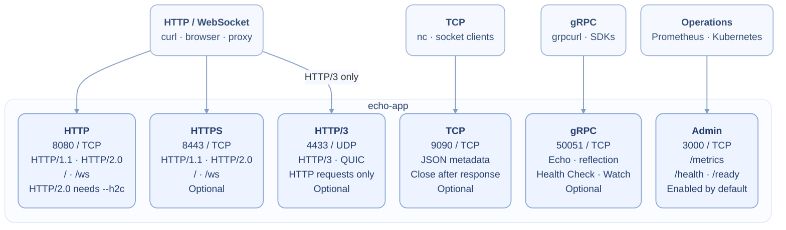

# echo-app — Multi-protocol network diagnostics

[](https://github.com/philipschmid/echo-app/actions/workflows/ci.yaml) [](https://github.com/philipschmid/echo-app/actions/workflows/docker.yaml) [](https://github.com/philipschmid/echo-app/actions/workflows/release.yaml)

A Go service for testing network paths, proxies, and load balancers. Connect over
HTTP, HTTPS, HTTP/3, TCP, or gRPC to inspect the receiving server and request.
WebSocket connections echo text and binary messages.

## Connect to echo-app



HTTP and admin listeners are enabled by default; the others are opt-in.
WebSocket upgrades use HTTP/1.1 on `/ws`. Ports are configurable.

## Quick start

Run the default HTTP and admin listeners, published only on localhost:

```bash
docker run --rm --read-only --cap-drop=ALL --security-opt=no-new-privileges \
  -p 127.0.0.1:8080:8080 -p 127.0.0.1:3000:3000 \
  ghcr.io/philipschmid/echo-app:main
```

In another terminal:

```bash
curl -sS http://localhost:8080/
curl -fsS http://localhost:3000/ready
```

The image runs as UID/GID `65532`. The `main` tag follows the main branch; pin a
version or digest for repeatable deployments.

To build locally with Go 1.26 or newer:

```bash
make build-quick
./echo-app --tls --tcp --grpc --quic
```

## Example response

With `--tls --print-http-request-headers`, a locally tested request through a
reverse proxy returned this HTTPS response (abridged):

```json
{
  "hostname": "echo-app-demo",
  "listener": "TLS",
  "source_ip": "172.21.0.3",
  "http_version": "HTTP/2.0",
  "http_method": "GET",
  "http_host": "echo.example.test",
  "http_request_uri": "/checkout?test=42",
  "remote_addr": "172.21.0.3:46186",
  "local_addr": "172.21.0.2:8443",
  "tls_version": "TLS 1.3",
  "tls_server_name": "echo-app-demo",
  "tls_negotiated_protocol": "h2",
  "headers": {
    "Authorization": ["[REDACTED]"],
    "X-Forwarded-For": ["172.21.0.1"]
  }
}
```

See which backend answered, the request it received, and the protocol negotiated
on that connection. `source_ip` remains the socket peer (here, the proxy), while
the forwarded client address stays in a header and `Authorization` is redacted.

## Endpoints at a glance

| Listener | Default port | Connect to | Enable |
| --- | --- | --- | --- |
| HTTP | `8080/TCP` | JSON metadata; `/ws` for WebSocket echo | Always on; optional `--h2c` |
| HTTPS | `8443/TCP` | JSON metadata; `/ws` for WSS | `--tls` |
| HTTP/3 | `4433/UDP` | Any path except `/ws` | `--quic` |
| TCP | `9090/TCP` | One JSON metadata response followed by EOF | `--tcp` |
| gRPC | `50051/TCP` | `echo.EchoService/Echo`, standard Health, reflection | `--grpc`; optional `--grpc-tls` |
| Admin | `3000/TCP` | `/metrics`, `/health`, `/ready` | On by default; `--metrics=false` disables it |

## Version plan

Version 1.3.0 is the final planned 1.x release. The browser UI, automatic
certificate management, and related major changes are planned for 2.0.0+.

## Guides

- [Usage](docs/usage.md): connection examples, response controls,
  certificates, WebSocket, health checks, and metrics.
- [Configuration](docs/configuration.md): flags, environment variables, defaults,
  and validation.
- [Kubernetes](docs/kubernetes.md): deployment, services, probes, and pod security.
- [Development](docs/development.md): builds, tests, integration checks, and images.

Keep the admin listener private. Common credential headers are redacted by default;
`--unsafe-headers` disables that protection.

[Apache 2.0 license](LICENSE).
