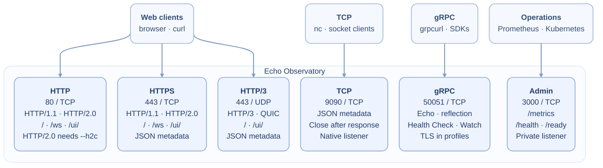
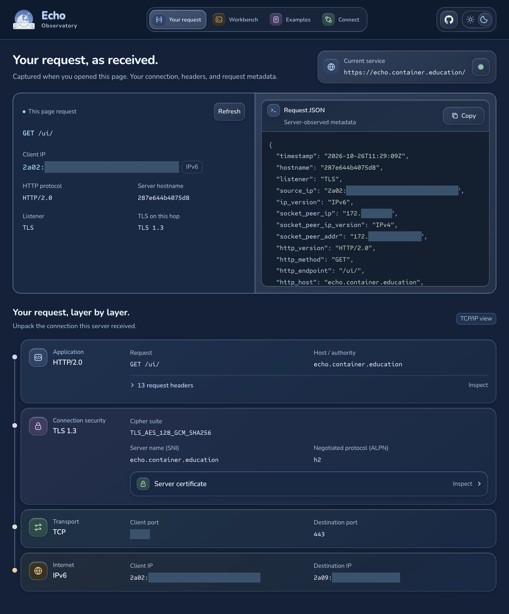
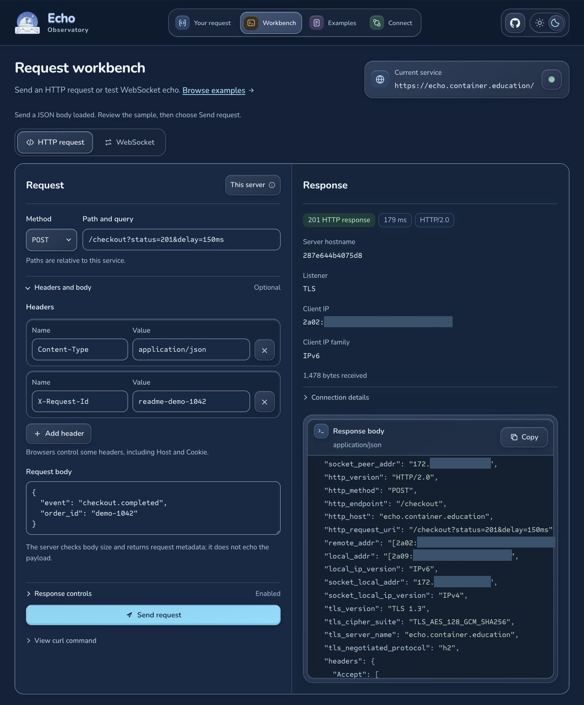

# Echo Observatory — Multi-protocol network diagnostics

[](https://github.com/philipschmid/echo-observatory/actions/workflows/ci.yaml) [](https://github.com/philipschmid/echo-observatory/actions/workflows/docker.yaml) [](https://github.com/philipschmid/echo-observatory/actions/workflows/release.yaml)

A Go service for testing network paths, proxies, and load balancers. Connect over
HTTP, HTTPS, HTTP/3, TCP, or gRPC to inspect the receiving server and request.
WebSocket connections echo text and binary messages. IPv4 and IPv6 requests
report the received client address and IP family in the UI and JSON.
An optional [trusted PROXY protocol mode](docs/configuration.md#trusted-proxy-protocol)
preserves original client addresses behind a TCP proxy while TLS stays in the app.

## Connect to Echo Observatory



The map shows the standard exposed deployment ports.
The embedded UI uses `/ui/` on HTTP, HTTPS and HTTP/3; `/` returns JSON.
WebSocket upgrades use HTTP/1.1 on `/ws`. gRPC stays on its own port.
For public deployments, set `--public-url` to enable [search discovery](docs/usage.md#search-discovery).

## Quick start

Build and start the on-prem profile:

```bash
docker compose up --build -d
```

Open [localhost/ui/](http://localhost/ui/) to inspect your request and its network
layers, or [Workbench](http://localhost/ui/workbench/) to test HTTP and WebSocket.
HTTPS and HTTP/3 use a self-signed demo certificate until you supply
trusted certificates; see [usage](docs/usage.md#use-certificates-and-mutual-tls).

```bash
curl -sS http://localhost/
curl -sk https://localhost/   # Demo certificate only.
curl -fsS http://localhost:3000/ready
```

The container runs as UID/GID `65532`, with a read-only filesystem and all
capabilities dropped. Admin port 3000 is published only on loopback.
For binary builds and unprivileged development ports, see [development](docs/development.md).
Self-hosted defaults impose no rate or daily transfer quota; public instances
can opt in with [`--protection`](docs/configuration.md#abuse-protection).

## Browser UI

Try the [live demo](https://echo.container.education/ui/) to inspect your request,
TLS connection and TCP/IP layers, or send a request from the workbench.



<details>
<summary>Workbench: a JSON POST with a custom header, HTTP 201 and a 150 ms delay</summary>

The sample checkout payload is synthetic. The response shows request metadata,
the negotiated protocol and measured duration.



</details>

## Example response

An abridged HTTPS response with `--tls --print-http-request-headers`:

```json
{
  "hostname": "echo-observatory-demo",
  "listener": "TLS",
  "source_ip": "172.17.0.1",
  "ip_version": "IPv4",
  "http_version": "HTTP/2.0",
  "http_method": "GET",
  "http_host": "echo.example.test",
  "http_request_uri": "/checkout?test=42",
  "remote_addr": "172.17.0.1:56536",
  "local_addr": "172.17.0.2:18443",
  "tls_version": "TLS 1.3",
  "tls_server_name": "localhost",
  "tls_negotiated_protocol": "h2",
  "headers": {
    "Authorization": [
      "[REDACTED]"
    ],
    "X-Forwarded-For": [
      "127.0.0.1"
    ]
  }
}
```

See which backend answered, the request it received, and the protocol negotiated
on that connection. By default, `source_ip` is the socket peer (here, the proxy),
while forwarded HTTP headers remain untrusted and `Authorization` is redacted.
Trusted PROXY protocol mode reports the original client in `source_ip` and
preserves the transport peer in separate `socket_peer_*` fields.

## Endpoints at a glance

| Listener | Exposed port | Internal default | Connect to |
| --- | --- | --- | --- |
| HTTP | `80/TCP` | `8080/TCP` | JSON; `/ws` for WebSocket; `/ui/` for the UI |
| HTTPS | `443/TCP` | `8443/TCP` | JSON; `/ws` for WSS; `/ui/` for the UI |
| HTTP/3 | `443/UDP` | `4433/UDP` | JSON; `/ui/` for the UI; no WebSocket |
| TCP | `9090/TCP` | `9090/TCP` | One JSON metadata response followed by EOF |
| gRPC | `50051/TCP` | `50051/TCP` | Echo, standard Health and reflection; TLS in deployment profiles |
| Admin | **Private** `3000/TCP` | `3000/TCP` | `/metrics`, `/health`, `/ready` |

The [Compose](compose.yaml) and [Kubernetes](docs/kubernetes.md) profiles use
these exposed ports and enable all echo listeners.
The bare binary starts only HTTP and admin by default; other listeners remain
opt-in. All bind ports are configurable. Existing 1.x image paths are unchanged.

## Version 2

Use [v2.1.0](https://github.com/PhilipSchmid/echo-observatory/releases/tag/v2.1.0)
for a stable release. Pin `ghcr.io/philipschmid/echo-observatory:2.1.0` for
repeatable container deployments.

Version 2.1 adds the [Grafana operations dashboard](dashboards/README.md),
certificate validity metrics, and rate-limit headroom and usage metrics.

Version 2.0 adds the browser UI, automatic certificate management, and the
renamed executable. Images starting with 2.0.0 use
`ghcr.io/philipschmid/echo-observatory`;
existing 1.x images remain at `ghcr.io/philipschmid/echo-app`.
See [upgrading to 2.0](docs/migration-v2.md) for configuration and metrics changes.

## Guides

- [Usage](docs/usage.md): browser UI, connection examples, response controls,
  certificates, WebSocket, health checks, and metrics.
- [Configuration](docs/configuration.md): flags, environment variables, defaults,
  and validation.
- [Monitoring](docs/monitoring.md): private health endpoints, metric reference,
  and PromQL examples.
- [Grafana dashboard](dashboards/README.md): portable operations dashboard,
  import instructions and a manual update target.
- [Privacy](https://echo.container.education/ui/privacy/): the public demo's data
  handling and contact details. Self-hosted operators can review
  [privacy and logging](docs/usage.md#privacy-and-logging).
- [Kubernetes](docs/kubernetes.md): deployment, services, probes, and pod security.
- [Development](docs/development.md): builds, tests, integration checks, and images.

Runs on-premises and offline too: use the default self-signed certificate or
supply your own PEM certificate and key. ACME is optional.

Keep the admin listener private and use synthetic data. Common credential headers
are redacted by default; `--unsafe-headers` reveals them in returned diagnostics.

[Apache 2.0 license](LICENSE).
